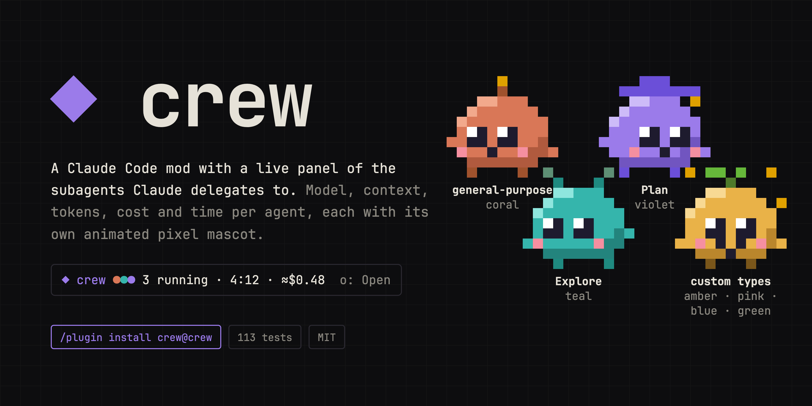
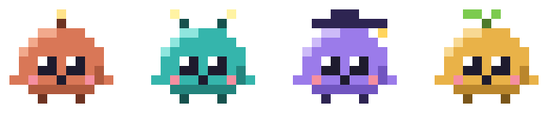
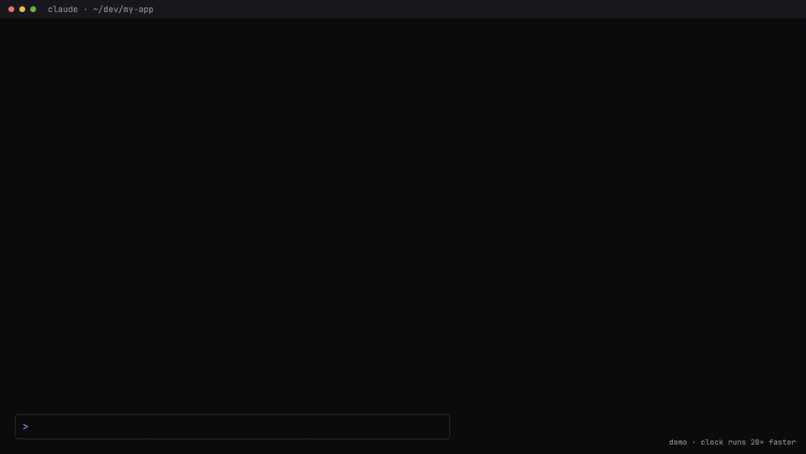
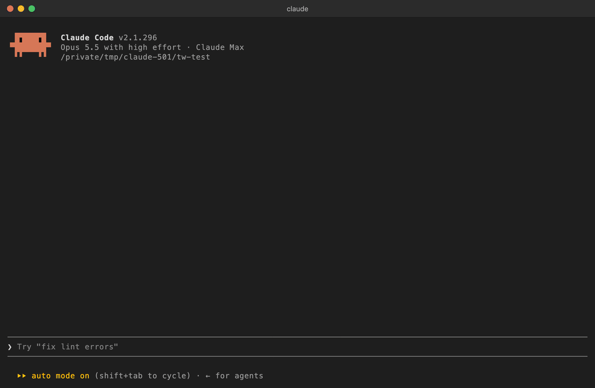
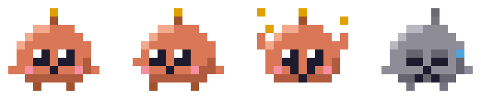

<div align="center">



# ◆ crew

**A Claude Code mod with a live panel of the subagents Claude delegates to — each with its own animated pixel mascot.**

[](https://code.claude.com/docs/en/plugins/mods/overview)
[](#compatibility)
[](LICENSE)





<sub>An animation of the pane, drawn with crew's own sprites and layout; the clock runs 20× faster than a real session.</sub>

</div>

When Claude hands work to subagents, the transcript tells you little while they run: which
ones are still going, on which model, how full their context is, what they have cost.
Crew puts all of it in one pane — stat cards for the session, a card per running agent,
a list of the ones that finished — and a one-line band above the prompt while anything runs.

```text
◆ crew · 1 running · 3 done · 1 failed

╭──────────────────╮ ╭──────────────────╮ ╭────────────────────╮
│ Session cost     │ │ Session tokens   │ │ Session time       │
│ ≈$1.15           │ │ 948.7k           │ │ 12:18              │
╰──────────────────╯ ╰──────────────────╯ ╰────────────────────╯

RUNNING · 1
 ▀▄   ▄▀  Scan the repo for TODO markers                       ●
 ▄█████▄  Explore · haiku 4.5 · high · step 7 · Bash
▀███████▄ ━━━━━━━━━━──────────────────────────────────── ctx 21%
 █▀▀▀▀█▀  207.5k tok · 12 tools · ≈$0.05 · 5:35

FINISHED · 4                                         c: Collapse
✓ Review the auth module     sonnet 4.5 ·  61.7k · ≈$0.08 · 1:48
✗ Run the flaky tests        sonnet 4.5 · 118.4k · ≈$0.12 · 4:51
✓ Draft the migration plan   opus 5.5   ·  88.1k · ≈$0.29 · 3:02
✓ Map the API routes         haiku 4.5  ·  52.0k · ≈$0.02 · 2:10
```

*(In the terminal the mascot is drawn in full color, two pixels per cell. The Session cost card here
is crew's estimate, marked `≈`: the main loop's share plus each agent's.)*

## In a real session

<p align="center"></p>

<p align="center"><sub>Recorded in a real Claude Code 2.1.299 session; two quiet stretches are cut.</sub></p>

## Install

Inside Claude Code:

```text
/plugin marketplace add flaviorg/crew
/plugin install crew@crew
```

Then start a new session, or run `/reload-plugins`. Crew is also listed in my
[claude-mods](https://github.com/flaviorg/claude-mods) marketplace with my other mods.

## What you see

- **Stat cards** — totals for the whole session, the main loop included, not just the
  agents below them: **Session cost** (the session's real cost when Claude Code reports
  it, else an estimate marked `≈`), **Session tokens** (everything the session's model
  responses reported: main loop and subagents, input, output and cache) and **Session
  time** (since the session started). A narrow card says just Cost, Tokens and Time; on a
  narrower pane they fold into one line.
- **Running** — a card per agent: its mascot, its description and a status dot; then its
  type, model, effort, step count and last tool; a thin bar for how full its context is
  (a row of `━` in the terminal; in the Desktop app, a bar three pixels tall that fills
  as the context does); and its tokens, tool calls, estimated cost and time. An agent that finishes stays here
  for three seconds to celebrate (`✓`) or droop (`✗` failed, `■` stopped), counted under
  the title as just finished (`RUNNING · 1 · JUST FINISHED · 2`), then moves on.
  Past 30 cards, one line says how many more run. When nothing runs, the idle mascot is
  back with a line saying so.
- **Finished** — newest first, with `✓`, `✗` or `■`, the model, tokens, cost and time, set
  out as a table: the columns line up from row to row.
  Its `c: Collapse` button folds it and `e: Expand` unfolds it (`c: Hide` and `e: Show` in
  a narrow pane); the choice sticks across sessions. Past 50 rows, one line says how many
  more.
- **The band** — while anything runs, one line above the prompt: a dot per live agent in
  its mascot's color, then the run so far — every agent since the band appeared, the
  ones already under Finished too: how many run and how many ended, for how long (the
  clock stops when the last one ends) and their estimated cost. `o: Open` opens the pane,
  or brings it to the front.

  ```text
  ◆ crew ●● 2 running · 1 done · 0:42 · ≈$0.18  o: Open
  ```

The pane opens by itself the first time Claude delegates, if the terminal is wide enough
for a pane nobody asked for (144 columns); otherwise a toast says to run `/crew`.

## The mascots

Each built-in agent type has its own head piece and coat. Custom types share the sprout and
take one of four coats by name, so a glance tells most of them apart.

| Agent type | Head piece | Coat |
|---|---|---|
| `general-purpose` (and forks) | an antenna | coral `#D97757` |
| `Explore` | feelers | teal `#35B5AC` |
| `Plan` | a cap | violet `#9B7BEA` |
| any custom type | a sprout | amber, pink, blue or green — always the same one for the same type |



| Pose | When | What it does |
|---|---|---|
| idle | the empty pane | blinks now and then |
| working | the agent runs | looks left and right, taps, steps; its tip pulses |
| done | it finished | throws its hands up and cheers while sparkles twinkle |
| failed | it failed or was stopped | turns grey and droops; a tear rolls down |

Every pose plays at four frames a second, each agent from its own point in the loop. The
pieces that stand on the terminal's background (head pieces, feet, tips, sparkles) keep to
middle tones, so they show on dark and light themes alike. A mascot is 9 x 8 pixels: in
the terminal, 9 columns by 4 rows, one row per line of its card; in the Desktop app, about
two lines of text tall. The pixel art is original: [`hooks/sprites.ts`](hooks/sprites.ts)
draws every frame from one table of parts (body, head pieces, eyes, mouth, hands, feet).

## Commands

| Command | What it does |
|---|---|
| `/crew` | Shows the pane, or hides it when it is showing |

Claude Code shows one mod pane at a time, docked or above the prompt, with a tab for each;
`/crew` (or the band's `o: Open`) brings crew's to the front.

## Options

Set them with `/plugin configure crew@crew`:

| Option | Values | Default | What it does |
|---|---|---|---|
| `autoOpen` | `on`, `off` | `on` | Open the pane when Claude first delegates to a subagent (if the terminal is wide enough) |
| `band` | `on`, `off` | `on` | Show the one-line summary above the prompt while subagents run |
| `mascot` | `on`, `off` | `on` | Draw the animated mascots; `off` draws a dot in the agent's color |
| `prices` | JSON | *(empty)* | Override the price table, in $ per million tokens |

`prices` keys are model families (`opus`, `sonnet`, `haiku`, `fable`, `mythos`) or any
part of a model id; the longest match wins, and beats the built-in table. An override's
rates apply to every request, long ones too. For example:

```json
{ "opus": { "input": 4, "output": 20, "cacheRead": 0.2, "cacheWrite": 5 },
  "opus-4-1": { "input": 15, "output": 75, "cacheRead": 1.5, "cacheWrite": 18.75 } }
```

The built-in table is Claude Code's own list prices (the model catalog it ships and prices
its session cost from), in $ per million tokens. A release it does not list is priced as
its family's newest. Haiku 5.5 has a second row: a request whose prompt (input and cache)
is past 100k tokens costs 5× as much, all of it, and crew prices each such request at
that row, as Claude Code does.

| Model | Input | Output | Cache read | Cache write |
|---|---|---|---|---|
| Opus 5.5 | 4 | 20 | 0.20 | 5 |
| Opus 4.5 – 5 | 5 | 25 | 0.50 | 6.25 |
| Opus 4, 4.1 | 15 | 75 | 1.50 | 18.75 |
| Sonnet 5.5 | 2 | 10 | 0.10 | 2.50 |
| Sonnet 5 | 2 | 10 | 0.20 | 2.50 |
| Sonnet 3.5 – 4.6 | 3 | 15 | 0.30 | 3.75 |
| Haiku 5.5 | 0.10 | 0.50 | 0.01 | 0.125 |
| Haiku 5.5, a request past 100k prompt tokens | 0.50 | 2.50 | 0.05 | 0.625 |
| Haiku 4.5 | 1 | 5 | 0.10 | 1.25 |
| Haiku 3.5 | 0.80 | 4 | 0.08 | 1 |
| Fable 5.1, Mythos 5.1 | 10 | 50 | 0.25 | 12.50 |
| Fable 5, Mythos 5 | 10 | 50 | 1 | 12.50 |

## About the numbers

- **The Session cost card** is Claude Code's own figure for the whole session, the main
  loop's share included, when it has one. Only when it does not is it crew's estimate,
  marked `≈`. So it is more than the agents' costs added up; the band's `≈` is theirs alone.
- **An agent's cost** is always an estimate (`≈`): its tokens times the price table.
  Claude Code reports the session's cost, not each subagent's. A model with no price
  shows `—`. A cache write is priced as the 5-minute kind (1.25× input), which is what a
  subagent writes unless its settings ask for an hour; hooks are not told an hour's
  writes (2× input), fast mode or US-only inference apart, so those cost more than shown.
- **Tokens** are counted once, from each model response. The total a turn reports at its
  end is the same tokens again, so it is not added.
- **Context %** is the agent's last request (input plus cache) over its model's window:
  the session's window when the agent runs the main model, a million for a `[1m]` model,
  200k otherwise. It says how full the agent's context is; it is not progress.
- **Time** runs from the spawn and stops when the agent ends. An agent that works again (a
  teammate's next turn, or a stopped agent resumed) picks up where its clock stopped.
- **Failures and kills** that no turn end reports are picked up from Claude Code's agent
  list every two seconds while an agent runs; so is the end of a turn of a teammate in a
  terminal pane of its own. Agents started by a workflow are never in that list; they are
  not marked failed for it. One that the list never shows and that has not been heard from
  for 30 minutes counts as stopped, so the band does not run for the rest of the session.

## Privacy

Crew reads only what Claude Code tells its hooks — subagent spawns, tool calls, model
requests and turn ends — and asks Claude Code for its list of agents, the session's usage
and the main model. It runs no commands, reads no files of yours and makes no network
requests. It stores one thing, whether Finished is collapsed, in its own plugin store.
You can confirm this before installing:

```bash
claude plugin validate ./crew
```

The `calls:` line lists every mods API call it makes.

## Compatibility

Tested with Claude Code **2.1.299** in the terminal and the Desktop app's Code tab. The
terminal draws the mascots as pixel art in half blocks; the Desktop app draws the same
pixels as an animated SVG, and each running card's context bar as a picture three pixels
tall (a row of `━` there comes from a wider font than the cell, and wraps). A pane Claude Code opens without being asked needs a terminal
144 columns wide (110 once you have opened it yourself); `/crew` opens it at any width.
A drawing has a size limit, so with many agents at once only the first ones get a mascot
(about thirty in the terminal, eight in the Desktop app, where the bars take some of the
room) and the rest get a colored dot.

## Development

```bash
claude plugin validate --strict .   # manifest, hooks and calls
claude plugin test .                 # 134 tests, no session or sign-in needed
claude --plugin-dir .                # try it in a session; edits hot-reload
```

`hooks/register.ts` is the only file that touches the mods API. The rest is pure and
tested on its own: `sprites.ts` (the mascots and their encoders), `pricing.ts` (prices,
model names, number formats), `roster.ts` (the agents' lifecycle) and `view.ts` (the text
of every line).

## Credits

The mascots are original pixel art. Crew is written from scratch against the public
Claude Code mods API.

## License

[MIT](LICENSE) © flaviorg
